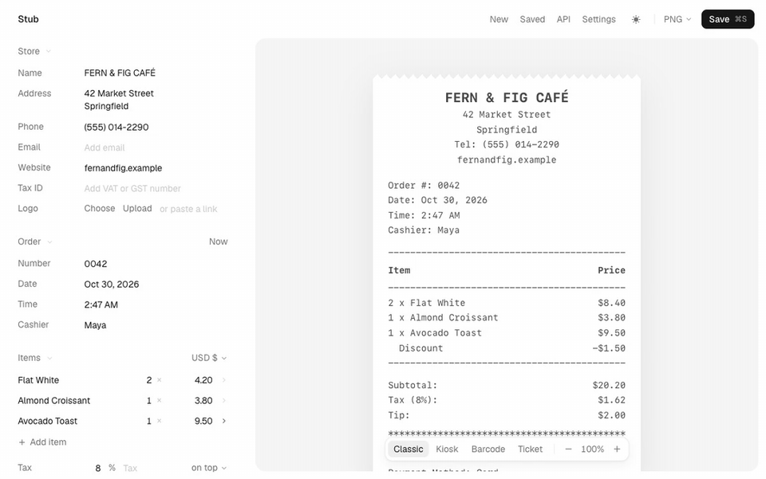

# Stub

A receipt maker for the web. Edit a receipt in the browser, watch the preview update as you type, and save it as a PNG, JPEG, PDF or HTML file. The same receipts come from an HTTP API, so Postman, curl or your own code can make them too.

[Live site](https://stub.vedantagrw.com)



The full clip is in [docs/demo.mp4](docs/demo.mp4).

## Features

- Four templates: an itemised till receipt, a self-service order slip, a barcode slip and a ticket with a tear-off stub
- 78 generic logo marks to pick from, or upload your own
- Tax on top or included (VAT, GST), item discounts, tips, cash change and 28 currencies
- Barcodes and QR codes that scan
- An HTTP API that takes the same payload as Receiptable
- Light and dark mode (press `D`)

## Using the website

- Edit on the left. The preview on the right is what gets saved.
- Press ⌘S (Ctrl S on Windows and Linux) to save in the format shown next to the Save button. Files go to your Downloads folder. In Chrome and Edge you can instead pick a folder once in Settings, and saves go straight into it.
- New starts the next receipt for the same store, with the order number bumped.
- Saved lists the receipts you've saved in this browser. Click one to keep editing it.
- The draft, your settings and saved receipts are kept in this browser, so a refresh loses nothing. None of it is stored on a server.

## API

The hosted API needs a free key. Open [stub.vedantagrw.com](https://stub.vedantagrw.com), click API, then Create key. The key is shown once, so copy it then. The same dialog shows the request for the receipt you're editing, as cURL, JavaScript or Python.

```sh
curl -X POST https://stub.vedantagrw.com/api/v1/receipt \
  -H 'Authorization: Bearer stub_...' \
  -H 'Content-Type: application/json' \
  -d '{
    "template": "default",
    "output": "png",
    "content": {
      "store": { "name": "Corner Bakery" },
      "currency": "inr",
      "items": [{ "name": "Croissant", "quantity": 2, "price": 120 }],
      "tax": { "rate": 5, "label": "GST" }
    }
  }' \
  -o receipt.png
```

Send `Content-Type: application/json` with every POST and DELETE, or the request is refused. `X-API-Key: <key>` works in place of the Authorization header.

| Field | What it does |
|---|---|
| `template` | `default`, `self-service`, `barcode` or `ticket` |
| `output` | `html`, `png`, `jpeg` or `pdf`. The response is the file. |
| `content` | What gets printed: store, items, tax, payment, codes and messages |
| `style` | Font, sizes, colours, width in characters, and `"edge": "zigzag"` for torn edges |
| `scale` | Image resolution from 1 to 4 (default 2) |
| `save` | Local app only. `true` also writes the file into your save folder and returns `{ id, filename, path }` |
| `filename` | Local app only. Name for the saved file |

Other endpoints:

- `GET /api/v1/receipt?template=ticket&output=png` returns an example of any template. HTML examples work without a key.
- `GET /api/v1/templates` lists the templates.
- `DELETE /api/keys` with your key in the Authorization header revokes it. The API dialog can revoke keys made in that browser too.
- `GET /api/health` reports whether the server can make images.

The payload matches [Receiptable](https://github.com/tom-draper/receiptable)'s, so its docs apply too.

### Limits

Stub runs on Cloudflare's free plan, so images and PDFs are rationed. HTML only counts toward the per-minute limit.

| Limit | |
|---|---|
| Requests per key | 30 a minute |
| Images and PDFs per key | 50 a day |
| Images and PDFs for the whole site | 180 a day |
| New keys per IP address | 5 a day |

Days reset at 00:00 UTC. Over a limit, the API answers `429` (or `503` when the whole site has run out) with a `Retry-After` header. The per-minute limit is approximate, since Cloudflare counts it separately in each data center. The local app has no limits.

Each image or PDF starts a fresh browser, and the free plan starts one every 20 seconds. An image request that comes right after another one waits for that, so it can take about 20 seconds.

## Running it locally

The local app is the same editor and API on your own machine, with no keys and no limits. It saves straight into a folder you set once (`~/Documents/Receipts` by default), and its API can save files too.

Requirements:

- Node 20+
- Google Chrome, Chromium, Edge or Brave for PNG, JPEG and PDF. HTML works without one.

```sh
git clone https://github.com/Vedant-29/stub.git
cd stub
npm install
npm start
```

`npm start` builds the app the first time (and again after the code changes), then opens http://localhost:4545. If that port is busy it uses the next free one. For hot reload while changing the code, run `npm run dev` instead.

The API is at http://localhost:4545/api/v1/receipt and takes the same requests as the hosted one, without a key.

### Environment variables

All optional, and all for the local app.

| Variable | Default | What it is for |
|---|---|---|
| `PORT` | `4545` | Port to listen on. The next free one is used if it's taken. |
| `HOST` | `127.0.0.1` | Set to `0.0.0.0` to reach the app from other devices on your network |
| `ALLOWED_HOSTS` | none | Extra hostnames to accept while on localhost, comma separated |
| `CHROME_PATH` | found automatically | Path to Chrome, Chromium, Edge or Brave |
| `RECEIPTS_DIR` | `~/Documents/Receipts` | Save folder until you change it in Settings |
| `STUB_DATA` | `./data` | Where settings, the draft and the save history are kept |
| `OPEN` | none | Set to `0` so `npm start` doesn't open the browser |

## Deployment

The website is a Cloudflare Worker. Every push to `main` runs [`.github/workflows/deploy.yml`](.github/workflows/deploy.yml), which type-checks, builds with `npm run build:cloud` and deploys with wrangler. It needs two repository secrets, `CLOUDFLARE_API_TOKEN` (made from the "Edit Cloudflare Workers" token template) and `CLOUDFLARE_ACCOUNT_ID`. Without them the workflow builds and skips the deploy.

To host your own copy:

1. Create a KV namespace with `npx wrangler kv namespace create stub-keys` and put its id in `wrangler.jsonc`.
2. Create a [Turnstile](https://developers.cloudflare.com/turnstile/) widget for your domain in managed mode. In `wrangler.jsonc`, set `TURNSTILE_SITE_KEY` to its site key and `TURNSTILE_HOSTNAMES` to your domain.
3. Change the custom domain under `routes` in `wrangler.jsonc`, then run `npm run deploy`.
4. Store the widget's secret with `npx wrangler secret put TURNSTILE_SECRET`.

`npm run preview:cloud` runs the hosted build on your machine with wrangler. It reads `TURNSTILE_SECRET` from a `.dev.vars` file, which git ignores.

## Notes

- On the website, PNG, JPEG and PDF files are made in your browser. A PDF saved there is an image of the receipt, so its text can't be selected. The API and the local app make PDFs with Chrome, and those have real text.
- The hosted API renders images with Cloudflare Browser Rendering. The local app uses your own Chrome through puppeteer-core (it never downloads a browser). The first save takes a second or two while Chrome starts, and Chrome closes again after five quiet minutes.
- Stub stores only a SHA-256 fingerprint of each API key, so a lost key can't be recovered. Revoke it and make a new one.
- Saved HTML files load their font from Google Fonts, so they look the same anywhere. Images and PDFs use the fonts bundled in `static/fonts`.
- On macOS, the local app needs your terminal app to have access to `~/Documents` to save there (System Settings > Privacy & Security > Files and Folders). If a save fails, choose another folder in Settings.
- With `HOST=0.0.0.0`, anyone on your network can use the local app and its API, including saving files. There's no login.
- The logo marks are generic on purpose. There are no real brand logos.

## Credits

- [Receiptable](https://github.com/tom-draper/receiptable) by Tom Draper, which this is based on. Stub is a new implementation with no code copied (Receiptable is SSPL licensed), but its templates and API payload follow Receiptable's design.
- Logo marks are made from [Lucide](https://lucide.dev) icons (ISC).
- Receipt fonts come from Google Fonts through [Fontsource](https://fontsource.org), under the SIL Open Font License (see `static/fonts/licenses`). The interface is set in [Geist](https://vercel.com/font).
- Barcodes are encoded with [JsBarcode](https://github.com/lindell/JsBarcode) and QR codes with [node-qrcode](https://github.com/soldair/node-qrcode).

## License

MIT. See [LICENSE](LICENSE). The bundled fonts keep their own SIL Open Font License.
