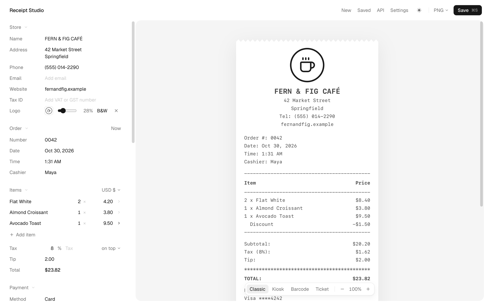

# Receipt Studio

A local app for making receipts. Edit one in the browser, watch it update as you type, and save it as a PNG, JPEG, PDF or HTML file straight into a folder. Everything the editor does is also an HTTP API, so you can make receipts from Postman, curl or your own code.



## Features

- Four templates: an itemised till receipt, a self-service order slip, a barcode slip and a ticket with a tear-off stub
- Saves into a folder you set once (`~/Documents/Receipts` by default), named after the store and order number
- 78 generic logo marks to pick from, or upload your own
- Tax on top or included (VAT, GST), item discounts, tips, cash change and 28 currencies
- Barcodes and QR codes that scan
- Light and dark mode (press `D`)

## Requirements

- Node 20+
- Google Chrome, Chromium, Edge or Brave for PNG, JPEG and PDF. HTML works without one.

## Setup

```sh
git clone git@github.com:Vedant-29/receipt-studio.git
cd receipt-studio
npm install
npm start
```

`npm start` builds the app the first time (and again after the code changes), then opens http://localhost:4545. If that port is busy it uses the next free one.

For hot reload while changing the code, run `npm run dev` instead.

## Using it

- Edit on the left. The preview on the right is exactly what gets saved.
- Press ⌘S (Ctrl S on Windows and Linux) to save in the format shown next to the Save button.
- New starts the next receipt for the same store, with the order number bumped.
- Saved lists everything you've saved. Click one to keep editing it.
- Settings has the save folder, the default format, image resolution and what happens after a save.
- Your draft is kept on disk, so closing the tab loses nothing.

## API

The body is the same JSON the editor builds. The API button in the app shows it for the receipt you're editing, as cURL, JavaScript or Python.

```sh
curl -X POST http://localhost:4545/api/v1/receipt \
  -H 'Content-Type: application/json' \
  -d '{
    "template": "default",
    "output": "png",
    "content": {
      "store": { "name": "Corner Bakery" },
      "currency": "inr",
      "items": [{ "name": "Croissant", "quantity": 2, "price": 120 }],
      "tax": { "rate": 5, "label": "GST" }
    }
  }' \
  -o receipt.png
```

| Field | What it does |
|---|---|
| `template` | `default`, `self-service`, `barcode` or `ticket` |
| `output` | `html`, `png`, `jpeg` or `pdf`. The response is the file. |
| `content` | What gets printed: store, items, tax, payment, codes and messages |
| `style` | Font, sizes, colours, width in characters, and `"edge": "zigzag"` for torn edges |
| `save` | `true` also writes the file into your save folder and returns `{ id, filename, path }` |
| `filename` | Name for the saved file |
| `scale` | Image resolution from 1 to 4 (default 2) |

Other endpoints:

- `GET /api/v1/receipt?template=ticket&output=png` returns an example of any template
- `GET /api/v1/templates` lists the templates
- `GET /api/health` reports whether Chrome was found

The payload matches [Receiptable](https://github.com/tom-draper/receiptable)'s, so its docs apply too. There's no API key, because the server only listens on your own machine.

## Environment variables

All optional.

| Variable | Default | What it is for |
|---|---|---|
| `PORT` | `4545` | Port to listen on. The next free one is used if it's taken. |
| `HOST` | `127.0.0.1` | Set to `0.0.0.0` to reach the app from other devices on your network |
| `ALLOWED_HOSTS` | none | Extra hostnames to accept while on localhost, comma separated |
| `CHROME_PATH` | found automatically | Path to Chrome, Chromium, Edge or Brave |
| `RECEIPTS_DIR` | `~/Documents/Receipts` | Save folder until you change it in Settings |
| `RECEIPT_STUDIO_DATA` | `./data` | Where settings, the draft and the save history are kept |
| `OPEN` | none | Set to `0` so `npm start` doesn't open the browser |

## Notes

- Images and PDFs are rendered by your own Chrome running in the background, through puppeteer-core (it never downloads a browser). The first save takes a second or two while Chrome starts; it closes again after five quiet minutes.
- Saved HTML files load their font from Google Fonts, so they look the same anywhere. Images and PDFs use the fonts bundled in `static/fonts` and work offline.
- On macOS, saving into `~/Documents` needs your terminal app to have access to that folder (System Settings > Privacy & Security > Files and Folders). If a save fails, choose another folder in Settings.
- With `HOST=0.0.0.0` anyone on your network can use the app and the API, including saving files. There's no login.
- The logo marks are generic on purpose. There are no real brand logos.

## Credits

- [Receiptable](https://github.com/tom-draper/receiptable) by Tom Draper, which this is based on. Receipt Studio is a new implementation with no code copied (Receiptable is SSPL licensed), but its templates and API payload follow Receiptable's design.
- Logo marks are made from [Lucide](https://lucide.dev) icons (ISC).
- Receipt fonts come from Google Fonts through [Fontsource](https://fontsource.org), under the SIL Open Font License (see `static/fonts/licenses`). The interface is set in [Geist](https://vercel.com/font).
- Barcodes are encoded with [JsBarcode](https://github.com/lindell/JsBarcode) and QR codes with [node-qrcode](https://github.com/soldair/node-qrcode).

## License

MIT. See [LICENSE](LICENSE). The bundled fonts keep their own SIL Open Font License.
